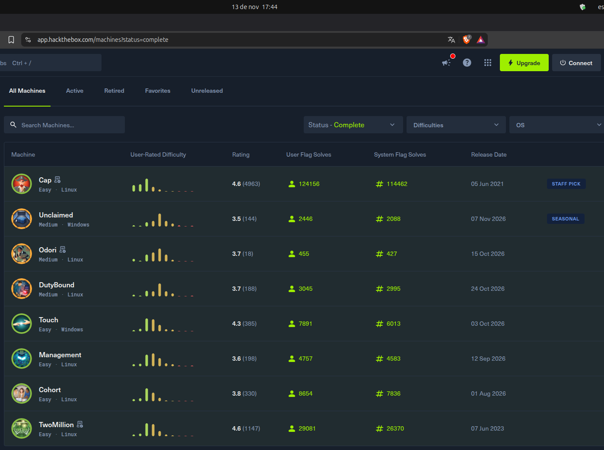

## COMPLETED LABS & MACHINES

This section documents machines and labs I have successfully completed during my learning.

Not every completed machine has a public write-up. Some platforms restrict the publication of solutions while their content remains active. In those cases, I choose to document the completion without disclosing the technical process.

**Completion records do not include:**
- Flags or room answers.
- Step-by-step exploitation procedures.
- Restricted walkthroughs or hints.
- Platform-specific exploitation chains or payloads.

Detailed write-ups and technical documentation are published only when the platform allows it.

#### You can also contact me if you want to see what I can do.

### Hack The Box - Machines

| Machine | Status | Operating System | Vulnerabilities / Techniques |
|---|---|---|---|
| Cap | Completed | Linux | IDOR, Information Disclosure, Password Reuse, Linux Capabilities Abuse |
| Odori | Completed | Windows | BitLocker Cracking, Credential Dumping, SFTP Restriction Bypass, SUID Abuse |
| Cohort | Completed | Linux | SSRF, Authentication Bypass, Remote Code Execution (RCE), TOCTOU |
| DutyBound | Completed | Linux | SQL Injection, Command Execution, X11 Session Hijacking, systemd Privilege Escalation |
| Management | Completed | Linux | Pre-Authentication RCE, Java Deserialization, Information Disclosure, Sudo Misconfiguration |
| Touch | Completed | Windows | Information Disclosure, Default Credentials, Kiosk Escape, MySQL UDF Abuse |
| TwoMillion | Completed | Linux | Broken Access Control, API Enumeration, JWT Manipulation, Command Injection, Kernel Exploitation |
| Unclaimed | Completed | Windows | Prompt Injection, SQL Injection, Command Execution, Credential Extraction, Privilege Escalation |

