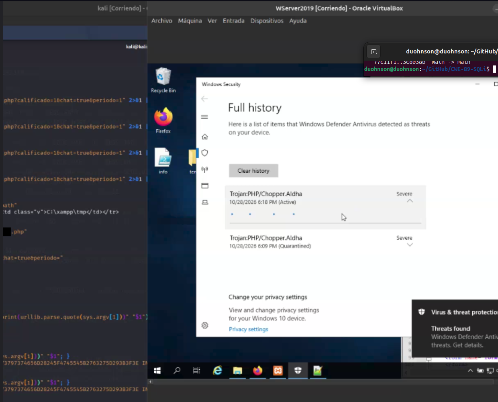

# Informe

## Resumen

Inyección SQL en `periodo` de `devolucion.php`, escalada a RCE. El archivo
se atacó sin modificarlo.

## Cadena

1. **Requisito.** `$periodop` se define solo dentro de la guarda de sesión y se usa
   en la línea 141. Sin sesión, la consulta queda `where id= order by id asc` y
   MariaDB falla por sintaxis. Se hizo persistir la sesión vía `save_path`.
2. **Inyección.** Contexto numérico. `#` neutraliza el `ORDER BY`.
3. **Oráculo.** El tipo devuelto decide la presencia del botón PDF: `1` vs `0`.
4. **Error-based.** `display_errors=On` + excepción mysqli no capturada →
   `UPDATEXML` devuelve el dato dentro del error, delimitado por `~`.
5. **Escritura.** `@@secure_file_priv` vacío → `INTO OUTFILE` en el docroot.
6. **Ejecución.** Apache como `LocalSystem` → `whoami` = `nt authority\system`.

## Impacto

Lectura íntegra de la BD, escritura en el docroot, ejecución de comandos,
persistencia. Credenciales `pentest` en el código.

## Detección

Defender y ESET marcaron el artefacto (`inyeccion.php`), no la inyección. El IDS de ESET
alertó por los patrones SQL sin bloquear: detección sin respuesta.

