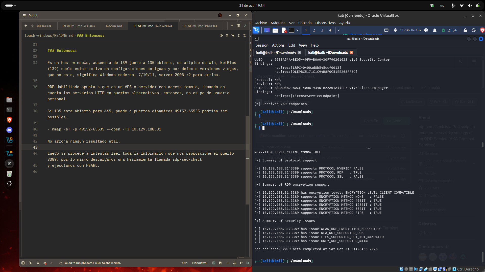
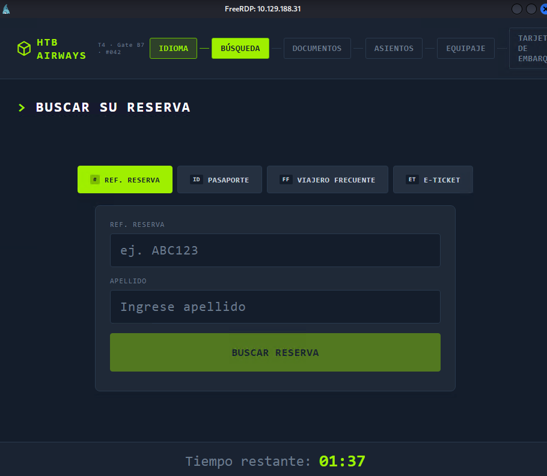
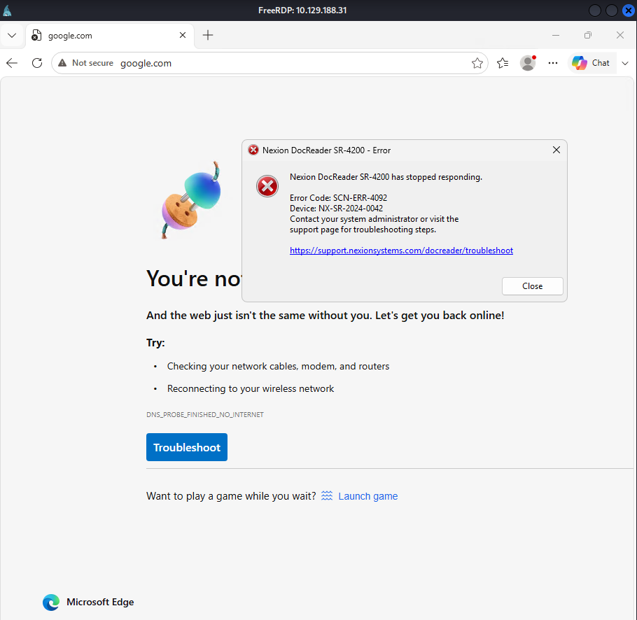
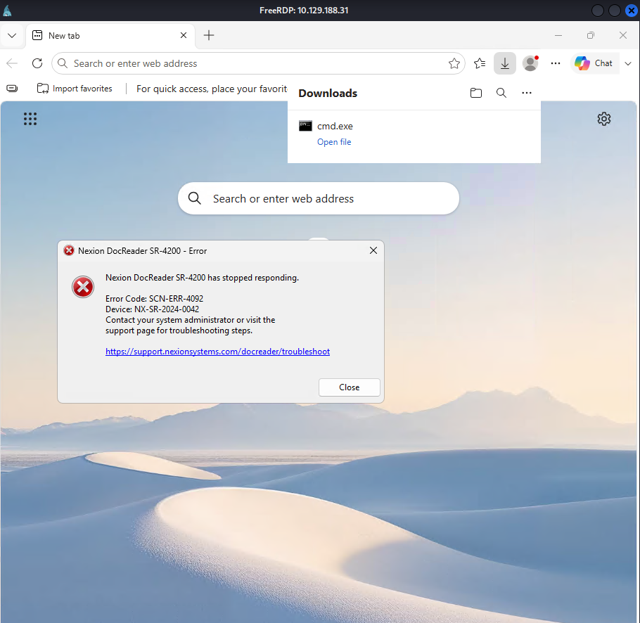
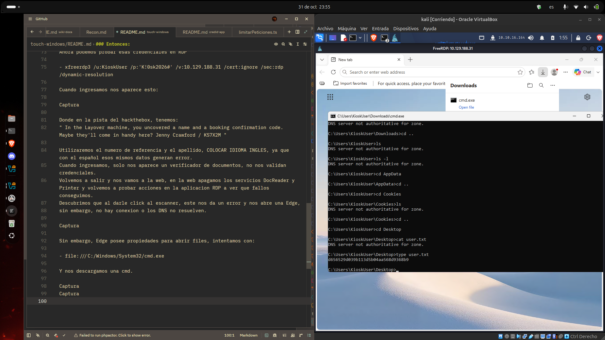
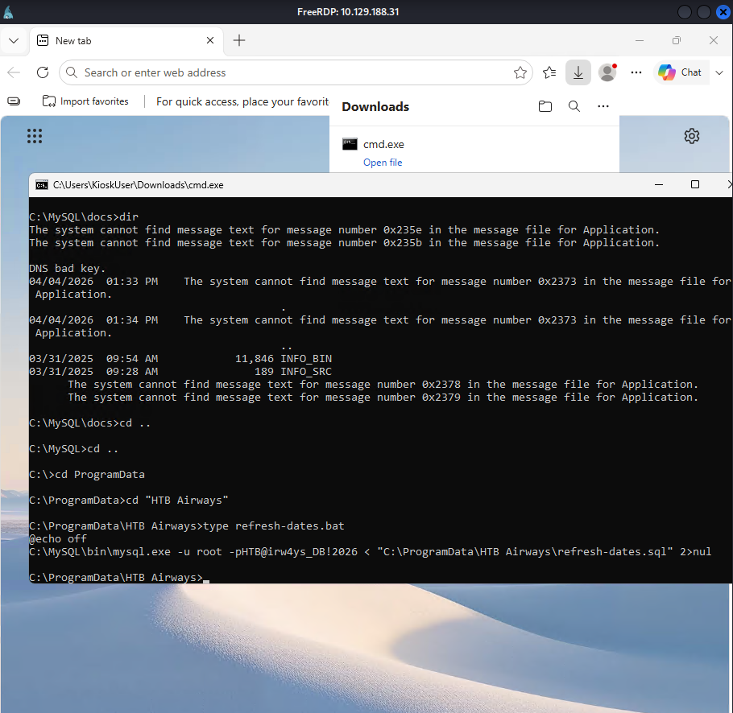

### Hack The Box | Touch.

Se realiza primer scaneo con nmap:

- nmap -sC -sV ip

Se identifican: 

PORT     STATE SERVICE       VERSION
135/tcp  open  msrpc         Microsoft Windows RPC
3389/tcp open  ms-wbt-server Microsoft Terminal Service
5985/tcp open  http          Microsoft HTTPAPI httpd 2.0 (SSDP/UPnP)
|_http-server-header: Microsoft-HTTPAPI/2.0
|_http-title: Not Found
8443/tcp open  http          Microsoft HTTPAPI httpd 2.0 (SSDP/UPnP)
|_http-cors: GET POST PUT OPTIONS
| http-title: Nexion DeviceHub - Login
|_Requested resource was /login
|_http-trane-info: Problem with XML parsing of /evox/about
|_http-server-header: Microsoft-HTTPAPI/2.0
Service Info: OS: Windows; CPE: cpe:/o:microsoft:windows

Donde se comprende que:

| Puerto | Servicio | Lectura |

| 135/tcp | msrpc - EPM | Windows confirmado. |

| 3389/tcp | RDP | Escritorio remoto habilitado. |

### Entonces: 

Es un host windows, ausencia de 139 junto a 135 abierto, es atipico de Win, NetBios(139) suele estar activo en configuraciones antiguas y por defecto versiones viejas, que no este, significa Windows moderno, 7/10/11, server 2008 r2 para arriba.

RDP Habilitado apunta a que es un VPS o servidor con acceso remoto, tomando en cuenta los servicios HTTP en puertos alternativos, entonces, no es pc de usuario personal.

Si 135 esta abierto pero 445, puede q puertos dinamicos 49152-65535 podrian ser posibles.

- nmap -sT -p 49152-65535 --open -T3 10.129.188.31

No arroja ningun resultado util.

Luego se procede a intentar leer toda la información que nos proporcione el puerto 3389, por lo mismo descargamos una herramienta llamada rdp-sec-check
y ejecutamos con PEARL.

Luego procedemos a verificar los servicios HTTP y HTTP que notamos en los puertos 
5985 y 8443.

Ingresando al 8443 encontramos lo siguiente, una web Nexion DocReader, y al inspeccionarla un texto en el frontend que dice:   <div class="login-hint" title="The default password is the device serial number included in your DeviceHub packaging."

Vamos a escanear el 8443 a ver que aparece, y usamos:

- feroxbuster -u http://10.129.188.31:8443 -w /usr/share/feroxbuster/raft-medium-directories.txt -t 20 -T 10 --scan-limit 2 --no-recursion

- feroxbuster -u http://10.129.188.31:8443/ -k -w /usr/share/seclists/Discovery/Web-Content/raft-medium-directories.txt

Se intentan varios escaneos incluidos con fuff, gobuster, owasp, pero no se da con los endpoints, entonces se busca documentación y pistas del laboratorio, donde empezamos a probar distintos endpoints genericos y normales, muy usados.

Se ejecuta un curl al api/status

- curl http://10.129.188.31:8443/api/status

Descubrimos el serial que aparecia en el frontend:
* NX-DH-2024-B7042 *

Una vez logeo, vuelvo a inspeccionar elemento y verifico que nos ofrece la web,
ahí encontramos un usuario y una contraseña ocultos:

Username	KioskUser
Password	K!0sk2026#

Ahora podemos probar esas credenciales en RDP

- xfreerdp3 /u:KioskUser /p:'K!0sk2026#' /v:10.129.188.31 /cert:ignore /sec:rdp /dynamic-resolution

Cuando ingresamos nos aparece esto: 

Donde en la pista del hackthebox, tenemos: 
" In the Layover machine, you uncovered a name and a booking confirmation code. Maybe they'll come in handy here? Jenny Crawford / KS7X2M "

Utilizaremos el numero de referencia y el apellido, COLOCAR IDIOMA INGLES, ya que con el español esos mismos datos generan error.
Cuando ingresamos, solo nos aparece un verificador de documentos, no nos validan credenciales.
Volvemos a salir y nos vamos a la web, en la web apagamos los servicios DocReader y Printer y volvemos a probar acciones en la aplicacion RDP a ver que fallos conseguimos.
Descubrimos que al darle click al escanner, este nos da un error y nos abre una Edge,
sin embargo, no hay conexion o los DNS no resuelven.

Sin embargo, Edge posee propiedades para abrir files, intentamos con:

- file:///C:/Windows/System32/cmd.exe

Y nos descargamos una cmd.

Encontramos el user.txt con type:

- d656529d039b113d5b04aa568d9368b9

Una vez logrado esto, podemos navegar con cd por todo el directorio, haciendo 
tabuladores para ver la disponibilidad de ficheros, y leyendo con type.

Despues de navegar y encontrar distintos ficheros, nos damos cuenta de instalaciones MySQL, y un .bat en ProgramData con la contraseña root.

- root

- -pHTB@irw4ys_DB!2026
